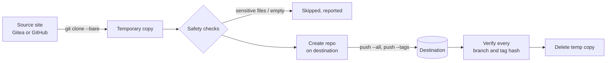

<div align="center">

```
┏━╸┏━┓╻ ╻┏┓╻┏━╸
┃╺┓┗━┓┗┳┛┃┗┫┃
┗━┛┗━┛ ╹ ╹ ╹┗━╸
```

**Copy all your repos from one git site to another, in one command.**


[Features](#-features) · [Quick start](#-quick-start) · [Preview](#-preview) · [Tokens](#-getting-tokens) · [Flags](#-commands-and-flags) · [How it works](#-how-it-works) · [Security](#-security) · [Troubleshooting](#-troubleshooting)

</div>

---

## ✨ Features

| | |
|---|---|
| 🧭 **Guided wizard** | Step 1: source site and token. Step 2: destination site and token. Then it pushes everything. |
| 🔁 **Gitea ⇄ GitHub** | Works in either direction. Gitea installed under a sub-path (like `/git`) is detected automatically. |
| 📦 **Full history** | Every branch, every commit and every tag, not just the latest files. |
| ✅ **Verified pushes** | After each push it compares every branch and tag hash with the source. A mismatch counts as a failure. |
| 🔒 **Private by default** | New repos are created private. Use `--keep-visibility` to copy each repo's setting instead. |
| 🛡️ **Safety checks** | Skips repos with `.env`, key or `.pem` files in the latest commit, and warns about them in older history. |
| ⏱️ **Rate-limit aware** | Paces repo creation and stops cleanly if GitHub throttles you. Re-runs pick up where it stopped. |
| 🎨 **Readable output** | Banner, colored status per repo, progress bar and a summary box. Colors turn off when piped. |

---

## 🚀 Quick start

**Requirements:** Python 3.7+ and `git`. Nothing to install.

```bash
chmod +x gsync.py
./gsync.py
```

1. **Source site:** give the link (for example your school's Gitea) and a token. The login is tested and the credentials are saved.
2. **Destination site:** give the link (for example `https://github.com`) and a token.
3. **Confirm once.** All your repos are copied, and each one is checked afterwards.

Next time, your saved sites are offered as a numbered list, so you don't enter anything again.

One-liner with links (it asks only for the tokens):

```bash
./gsync.py --src https://gitea.example.com/git/you --dst https://github.com/you --yes
```

> [!NOTE]
> Built and tested against local git repositories and simulated servers. Try it on a single throwaway repo before running it on everything.

---

## 🎬 Preview

Example output (colors are shown in a real terminal):

```
  ┏━╸┏━┓╻ ╻┏┓╻┏━╸
  ┃╺┓┗━┓┗┳┛┃┗┫┃
  ┗━┛┗━┛ ╹ ╹ ╹┗━╸
  copy all your repos from one git site to another

   STEP 3  5 repos found on https://gitea.example.com/git
    • private  ai-ethics
    • private  go-reloaded
    • private  net-cat
    • private  piscine-go
    • private  quad

   STEP 4  Pushing and verifying
  ✔ [ 1/5] ai-ethics    repo already existed; verified 2 branches, 1 tags identical
  ✔ [ 2/5] go-reloaded  repo created; verified 1 branches, 0 tags identical
         ⚠ sensitive-looking files in older commits: ['.env']
  ✖ [ 3/5] net-cat      push --all: destination repo already has different
                        history, so nothing was changed. ...
  ⚠ [ 4/5] piscine-go   sensitive-looking files: ['.env']
  ✔ [ 5/5] quad         repo created; verified 3 branches, 2 tags identical

  ╭─────────────────────────────╮
  │ 3 ok   1 skipped   1 failed │
  ╰─────────────────────────────╯
```

---

## 🔑 Getting tokens

| Site | Where | What it needs |
|---|---|---|
| **GitHub** | Settings → Developer settings → Personal access tokens → *Tokens (classic)* | The **`repo`** scope, and nothing else |
| **GitHub** (fine-grained) | Same page → *Fine-grained tokens* | *All repositories*, with **Administration** and **Contents** set to *Read and write* |
| **Gitea** | Settings → Applications → Generate New Token | Read access to repositories on the source, write access on the destination |

A classic token with only `repo` is the simplest option. If a call returns 403, the token is missing a scope. Never use your account password, because tokens can be revoked.

---

## 🧰 Commands and flags

| Command / flag | What it does |
|---|---|
| `./gsync.py` | Run the wizard (source, destination, push all) |
| `./gsync.py sites` | List saved sites |
| `./gsync.py forget user@host` | Delete a saved site and its token |
| `--src` | Source site: a saved `user@host`, or a link (only the token is asked) |
| `--dst` | Destination site: a saved `user@host`, or a link |
| `--yes` | Skip the confirmation question |
| `--verify-only` | Push nothing. Just compare every branch and tag on both sites |
| `--keep-visibility` | Copy each repo's public/private setting (default: everything private) |
| `--overwrite NAMES` | Comma-separated repo names whose destination history may be **replaced** (force push). Check the destination repo first |
| `--force` | Push even when sensitive-looking files are in the latest commit |

Set `NO_COLOR=1` for plain output.

Check your finished repos without changing anything:

```bash
./gsync.py --src you@gitea.example.com --dst you@github.com --verify-only
```

---

## ⚙️ How it works



1. **Clone:** a bare clone downloads the repo's whole git database (all commits, branches and tags).
2. **Check:** empty repos are skipped, and so are repos with `.env`, `.pem`, `.key` or SSH key files in the latest commit.
3. **Create:** the destination repo is created, or reused if it exists. Existence is checked first with a read-only call.
4. **Push:** all branches, then all tags.
5. **Verify:** the destination's branches and tags are compared with the source, name and commit hash. Identical hashes mean identical history and files.

Each source repo becomes its own **separate repo** with the same name on the destination.

---

## 🔒 Security

- **Where tokens live:** `~/.config/gsync/sites.json`, permissions `600` (folder `700`). **Tokens are stored in plain text**, so treat the file like an SSH key.
- **How tokens are used:** passed to git through environment variables scoped to the site. They never appear in URLs, command-line arguments or `.git/config`.
- **Good habits:** use tokens with only the scopes needed, set an expiry, and run `./gsync.py forget NAME` when you're done.
- **Private by default:** nothing becomes public unless you pass `--keep-visibility` for a repo that was public.

---

## 🚧 Limitations

<details>
<summary>What is <b>not</b> copied or checked</summary>

- Only **GitHub** and **Gitea** are supported. GitLab uses different API paths.
- Only git data is copied: **no** issues, pull requests, wikis, releases or repo settings.
- **Git LFS** files are not copied (only the small pointer files). The script warns when it sees LFS.
- Only what is on the source site is copied. Local commits you never pushed to it are not included.
- Files like `.env` found only in **older commits** produce a warning and are still pushed, because they are part of the history.
- It never force-pushes unless you pass `--overwrite` for that repo.
- Repos are processed one at a time.

</details>

---

## 🩺 Troubleshooting

| Message | Likely cause and fix |
|---|---|
| `Login failed (HTTP 401)` | Wrong or expired token |
| `Login failed (HTTP 403)` / `Cannot list repos` | Token is missing scopes |
| `Could not find a Gitea API` | Wrong link, VPN/network, or an unsupported site. The script prints the `curl` command to test it |
| `destination repo already has different history` | A repo with that name already exists on the destination. Look at it, then rename it there, or re-run with `--overwrite NAME` if it is disposable |
| `STOPPED: GitHub is rate-limiting repo creation` | GitHub's secondary rate limit. Wait 30-60 minutes **without retrying**, then run the same command. Finished repos are detected and skipped |
| `push ...: 403` | The destination token can't write. Use a classic token with `repo`, or fix the fine-grained permissions |
| `skipped (sensitive-looking files)` | Remove the files from the repo history, or re-run with `--force` if you are sure |
| `skipped (empty repo)` | The repo has no commits yet |

---

## 🤝 Use it responsibly

Check your school's or employer's rules before copying coursework or private code to another site. Keep the default of private repos unless you are sure about making something public.
